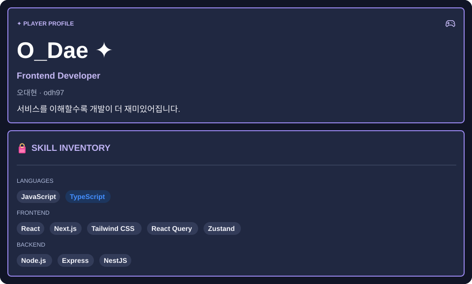
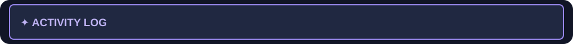
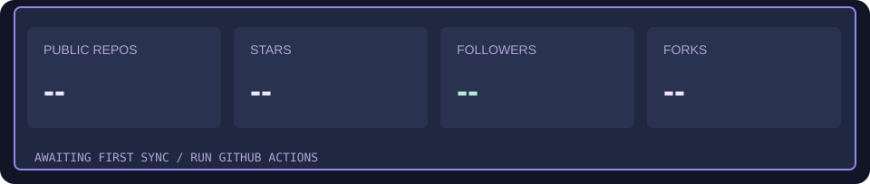

<!-- Design: assets/profile.svg + assets/skills.svg → assets/overview.svg | Setup: docs/SETUP.md -->

<!-- 본인이 제작한 캐릭터를 assets/avatar.png로 추가한 뒤 아래 한 줄의 주석을 해제하세요.

-->

기술 배지 보기

### Languages

### Frontend

### Backend

 

공개 데이터 기준 · 매일 자동 갱신 · 카드 하단에 마지막 갱신 시각 표시

  

